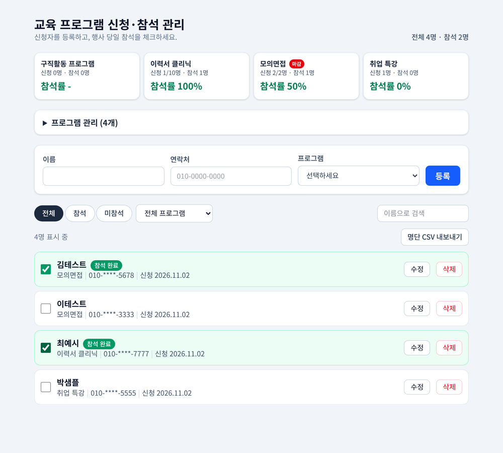

# 에듀체크 (EduCheck)

교육 프로그램 신청·참석 관리 앱

교육기관 운영 담당자가 프로그램 신청자를 등록하고, 행사 당일 참석을 체크하고, 프로그램별로 골라 보는 웹 앱입니다.
현재 버전: **v2.2** (수료 판정, 회차 수정, 출석표, 시연용 데이터까지)



> 화면의 이름과 연락처는 모두 가짜 데이터입니다.

- 명세 문서: [docs/](docs/) 폴더 (IDEA → PRD → TRD → DATA_MODEL → API_SPEC → COMPONENT_SPEC → TEST_CASES)

## 주요 기능
- 관리자 비밀번호 로그인 (로그인 12시간 유지, 탭을 닫으면 로그아웃, 1분에 5번 틀리면 잠시 막힘). 로그인하지 않으면 명단 API가 모두 거부됨
- 신청자 등록 (이름·연락처·프로그램), 연락처는 숫자만 쳐도 하이픈 자동 입력
- 같은 연락처로 같은 프로그램에 중복 신청 막기
- 참석 체크와 "전체 N명 · 참석 M명" 요약, 처리 중에는 버튼을 잠가 두 번 눌림 방지
- 참석 여부·프로그램 필터, 이름 검색
- 정보 수정 (실패하면 입력값 유지), 삭제 전 한 번 더 확인
- 명단의 연락처는 가운데를 가려서 표시 (`010-****-5678`)
- 프로그램별 신청·참석 인원과 참석률 카드, 정원이 차면 **마감** 표시
- 프로그램 관리: 화면에서 프로그램 추가·수정·삭제, 기간·장소·정원 설정 (정원이 차면 신청 막기)
- 회차 출석부: 여러 날 진행하는 프로그램은 날짜별 회차를 만들고 회차마다 출석 체크, 명단에 "출석 2/3회"와 프로그램 출석률 표시. 회차 날짜·메모 수정
- 수료 판정: 프로그램마다 수료 기준 출석률(기본 80%)을 정하면 기준을 넘은 사람에게 **수료** 표시, 요약·CSV에도 반영
- 회차별 출석표: 사람 × 회차 표를 CSV로 저장하거나 인쇄 (인쇄본은 연락처 가림)
- 시연용 가짜 데이터: 명령 하나로 프로그램·신청자·회차·출석을 채워서 바로 시연
- 지금 보이는(필터된) 명단을 엑셀용 CSV로 내려받기 (`신청자명단_YYYYMMDD.csv`, 연락처 전체 포함이라 파일 관리 주의)

## 기술 스택
- 화면: Next.js 15, React 19, TypeScript, Tailwind CSS, Jest + React Testing Library
- 서버: Python 3.12+, FastAPI, Pydantic v2, uv
- DB: SQLAlchemy 2.0 + Alembic (개발: SQLite 파일 / 배포: Neon Postgres)

## 폴더 구조

수업의 Todo 앱 가이드 구조(화면은 `app/`·`src/`, 서버는 `backend/`, 명세는 `docs/`)를 따릅니다. 자세한 설명은 [docs/TRD.md](docs/TRD.md)에 있습니다.

```text
personal_project/
├─ CLAUDE.md                    # 클로드 작업 규칙 (기술 스택, 폴더 구조, 금지 사항)
├─ README.md                    # 프로젝트 소개, 실행 방법 (지금 보는 문서)
├─ package.json                 # 화면 쪽 패키지와 명령 (npm run dev:all 등)
├─ dev-all.ps1                  # 서버와 화면을 터미널 하나로 켜는 스크립트
├─ .env.example                 # 화면용 환경 변수 예시 (NEXT_PUBLIC_API_URL)
│
├─ docs/                        # 명세 문서 (코드보다 먼저 씀)
│  ├─ IDEA.md                   # 아이디어, MVP, 빼는 것, 버전 로드맵
│  ├─ PRD.md                    # 기능 목록(F-01~), 사용자 스토리, 화면 문구
│  ├─ TRD.md                    # 기술 선택 이유, 폴더 구조, 데이터 흐름
│  ├─ DATA_MODEL.md             # 테이블과 필드, 검사 규칙
│  ├─ API_SPEC.md               # API 주소, 요청·응답, 에러 형식
│  ├─ COMPONENT_SPEC.md         # 화면 부품, Props, 동작과 문구
│  ├─ TEST_CASES.md             # 테스트 ID와 기대 결과 ("완성"의 기준)
│  └─ images/screenshot.png     # README용 실행 화면
│
├─ app/                         # Next.js 페이지
│  ├─ layout.tsx                # 모든 페이지를 감싸는 틀
│  ├─ page.tsx                  # 로그인 여부를 보고 로그인 화면 또는 관리 화면을 보여줌 (v2.0)
│  └─ globals.css               # Tailwind 불러오기
│
├─ src/
│  ├─ components/               # 화면 부품 (+ 같은 이름의 .test.tsx)
│  │  ├─ ApplicantForm.tsx      # 신청자 등록 폼
│  │  ├─ ApplicantList.tsx      # 명단 목록
│  │  ├─ ApplicantItem.tsx      # 신청자 한 줄 (참석 체크, 수정, 삭제 확인)
│  │  ├─ ApplicantFilter.tsx    # 참석 여부·프로그램 필터, 이름 검색
│  │  ├─ ApplicantSummary.tsx   # 전체 N명 · 참석 M명
│  │  ├─ ProgramSummary.tsx     # 프로그램별 신청·참석 인원, 참석률, 정원·마감
│  │  ├─ ProgramManager.tsx     # 프로그램 목록·추가·수정·삭제 (v1.2)
│  │  ├─ ProgramForm.tsx        # 프로그램 이름·기간·장소·정원 입력 (v1.2)
│  │  ├─ AttendanceBook.tsx     # 회차 출석부: 회차 추가·삭제, 회차별 출석 체크 (v1.3)
│  │  ├─ AdminDashboard.tsx     # 로그인 뒤의 관리 화면 전체 (데이터 불러오기·저장) (v2.0)
│  │  ├─ LoginForm.tsx          # 관리자 로그인 화면 (v2.0)
│  │  └─ ExportButton.tsx       # 명단 CSV 내보내기
│  ├─ lib/                      # 화면과 분리된 함수 (+ .test.ts)
│  │  ├─ applicantApi.ts        # FastAPI를 부르는 함수 모음
│  │  ├─ validation.ts          # 입력값 검사 (서버와 같은 규칙·문구)
│  │  ├─ filterApplicants.ts    # 필터 계산
│  │  ├─ format.ts              # 연락처 가리기, 하이픈 자동 입력, 날짜·기간 표시
│  │  ├─ programs.ts            # 프로그램 이름 찾기, 신청자 수·마감 계산 (v1.2)
│  │  ├─ attendance.ts          # 회차 정렬, 출석 횟수·참석 여부 계산 (v1.3)
│  │  ├─ authStorage.ts         # 로그인 토큰을 sessionStorage에 저장·읽기·지우기 (v2.0)
│  │  ├─ attendanceSheet.ts     # 회차별 출석표 만들기, CSV·인쇄용 HTML (v2.2)
│  │  ├─ download.ts            # 브라우저에서 파일 내려받기 (명단·출석표 CSV)
│  │  ├─ useSlowNotice.ts       # 3초 넘게 걸리면 "서버 깨우는 중" 안내 (v2.0.1)
│  │  └─ report.ts              # CSV 만들기, 프로그램별 요약 계산
│  ├─ types/applicant.ts        # 공유 타입 (신청자, 프로그램, 회차, 출석)
│  └─ test-utils/               # 테스트용 가짜 데이터 (makeApplicant, makeProgram, makeSession)
│
└─ backend/                     # FastAPI 서버
   ├─ pyproject.toml            # 서버 쪽 패키지와 pytest 설정
   ├─ uv.lock                   # 설치된 패키지 버전 고정
   ├─ .env.example              # 서버용 환경 변수 예시 (DB 주소, CORS)
   ├─ alembic.ini               # DB 마이그레이션 설정
   ├─ alembic/versions/         # 테이블을 만들고 바꾼 기록 (0001 신청자, 0002 프로그램 분리, 0003 회차·출석, 0004 수료 기준)
   ├─ app/
   │  ├─ main.py                # 서버 시작점: CORS, 에러 형식 통일, 라우터 등록
   │  ├─ routers/applicants.py  # /api/applicants 주소별 처리 (GET·POST·PATCH·DELETE)
   │  ├─ routers/programs.py    # /api/programs 주소별 처리 (v1.2)
   │  ├─ routers/sessions.py    # 회차·출석 주소별 처리 (v1.3)
   │  ├─ routers/auth.py        # 로그인 주소 (v2.0)
   │  ├─ auth.py                # require_admin: 토큰이 없으면 401 (v2.0)
   │  ├─ security.py            # 토큰 만들기·검사, 로그인 시도 제한 (v2.0)
   │  ├─ seed.py                # 시연용 가짜 데이터 넣기 (v2.2)
   │  ├─ schemas.py             # 요청·응답 검사 (Pydantic)
   │  ├─ repository.py          # 저장소 약속(Protocol) + 메모리 저장소
   │  ├─ sql_repository.py      # DB 저장소
   │  ├─ deps.py                # 라우터에 저장소를 넣어 주는 곳 (get_repo)
   │  ├─ models.py              # DB 테이블 정의 (programs, applicants, sessions, attendances)
   │  ├─ db.py                  # DB 연결과 세션
   │  ├─ config.py              # .env 설정 읽기
   │  ├─ middleware.py          # 예상 못 한 에러도 같은 형식의 500으로 (v2.2.1)
   │  └─ errors.py              # 404·409·업무 규칙 에러 (정원 초과 등)
   └─ tests/                    # pytest 테스트 (입력 검사, 저장소, 로그인, 신청자·프로그램·회차 API)
```

## 처음 한 번만 준비하기 (Windows PowerShell)

필요한 프로그램: Node.js LTS(`node -v`), Python 3.12 이상(`python --version`), uv(`uv --version`)
uv가 없으면: `powershell -ExecutionPolicy ByPass -c "irm https://astral.sh/uv/install.ps1 | iex"`

```powershell
# 0) uv 위치와 SQLAlchemy 설정을 계속 유지 (한 번만 실행 후 VS Code 재시작)
[Environment]::SetEnvironmentVariable("Path", "$env:USERPROFILE\.local\bin;" + [Environment]::GetEnvironmentVariable("Path", "User"), "User")
[Environment]::SetEnvironmentVariable("DISABLE_SQLALCHEMY_CEXT_RUNTIME", "1", "User")

# 1) 화면 쪽 패키지 설치 (프로젝트 최상위 폴더에서)
npm install

# 2) 화면용 서버 주소 파일 만들기
copy .env.example .env.local

# 3) 서버 쪽 패키지 설치 + DB 테이블 만들기
cd backend
uv sync
uv run python -m alembic upgrade head

# 4) 서버 설정 파일 만들기 → backend/.env 를 열어 ADMIN_PASSWORD= 뒤에 관리자 비밀번호를 적기 (v2.0)
copy .env.example .env
cd ..
```

`.env.local`이 없어도 기본 주소(`http://localhost:8000`)로 동작합니다.
`backend/.env`의 `ADMIN_PASSWORD`가 비어 있으면 로그인이 안 됩니다. 비밀번호를 바꾸면 서버를 다시 켜세요.
`AUTH_SECRET`을 비워 두면 서버를 다시 켤 때마다 다시 로그인해야 합니다. (개발 중에는 괜찮음)

## 실행하기 (터미널 하나)

```powershell
npm run dev:all
```

- 서버(`http://localhost:8000/docs`, API 시험 화면)와 화면(`http://localhost:3000`)이 함께 켜집니다.
- 화면에서 `backend/.env`에 적은 비밀번호로 로그인합니다.
- `/docs`에서 API를 시험하려면: `POST /api/auth/login`으로 토큰을 받고 → 오른쪽 위 **Authorize**에 토큰을 붙여 넣기
- `Ctrl + C` 한 번으로 둘 다 꺼집니다.
- 3000번을 다른 프로그램이 쓰고 있으면 먼저 정리하고 켭니다.

따로 켜고 싶을 때는 터미널 2개를 씁니다.

```powershell
# 터미널 1: 서버
cd backend
uv run python -m fastapi dev app/main.py

# 터미널 2: 화면
npm run dev
```

## 시연용 데이터 넣기 (v2.2)

신청자와 회차가 하나도 없는 DB에만 가짜 데이터(프로그램 4개, 신청자 12명, 회차 6개, 출석 기록)를 넣습니다.
이미 데이터가 있으면 아무것도 하지 않으니 실제 명단과 섞이지 않습니다. 이름과 연락처(`010-0000-...`)는 모두 가짜입니다.

```powershell
cd backend
uv run python -m app.seed
```

## 테스트

```powershell
npm test                                  # 화면 테스트 (Jest)
cd backend
uv run python -m pytest                    # 서버 테스트 (메모리 저장소)
uv run python -m pytest -m db              # DB 저장소 테스트 (backend/test.db)
```

## Windows에서 막힐 때

| 증상 | 해결 |
| --- | --- |
| `uv` 용어를 인식할 수 없음 | 위 0) 설정 후 VS Code 재시작. 급하면 `$env:Path = "$env:USERPROFILE\.local\bin;$env:Path"` |
| `애플리케이션 제어 정책에서 이 파일을 차단했습니다` (`alembic.exe` 등) | `uv run 명령` 대신 `uv run python -m 명령`으로 실행 |
| `DLL load failed ... _cache_key_cy` | `$env:DISABLE_SQLALCHEMY_CEXT_RUNTIME = "1"` 후 다시 실행 (0) 설정 시 자동) |
| 로그인할 때 "서버에 관리자 비밀번호가 설정되지 않았습니다" | `backend/.env`에 `ADMIN_PASSWORD=비밀번호`를 적고 서버 다시 켜기 |
| 화면에 "서버에서 오류가 발생했습니다" | 서버 터미널의 빨간 에러를 확인. `no such column`이면 `backend`에서 `uv run python -m alembic upgrade head` |
| 화면에 "서버에 연결할 수 없습니다" | 서버가 꺼져 있음. `npm run dev:all`로 다시 켜고 `http://localhost:8000/health` 확인 |

## 배포 환경 변수 (v1.0에서 사용, 실제 값은 쓰지 않음)

| 서비스 | 변수 이름 | 예시 값 | 설명 |
| --- | --- | --- | --- |
| Render | `DATABASE_URL` | `postgresql+psycopg://...` | Neon main 브랜치 주소 |
| Render | `ADMIN_PASSWORD` | (직접 정한 비밀번호) | 관리자 로그인 비밀번호 (v2.0) |
| Render | `AUTH_SECRET` | (긴 무작위 문자열) | 토큰 서명 키. 비우면 서버가 다시 켜질 때마다 로그아웃됨 |
| Render | `CORS_ORIGINS` | `https://○○.vercel.app` | 허용할 화면 주소, 쉼표로 여러 개, 끝에 `/` 없이 |
| Vercel | `NEXT_PUBLIC_API_URL` | `https://○○.onrender.com` | 서버 주소, 끝에 `/` 없이 |

Render 설정: Root Directory `backend`, Build `pip install uv && uv sync --frozen`,
Start `uv run uvicorn app.main:app --host 0.0.0.0 --port $PORT`, Health Check `/health`
(`backend/uv.lock`을 꼭 커밋하세요. `--frozen`이 이 파일을 씁니다.)

## 개인정보
- 시연용 프로젝트입니다. **실제 이름과 전화번호를 입력하지 마세요.** 테스트와 시연에는 가짜 데이터만 씁니다.
- 화면의 연락처는 가려서 보여주지만, 로그인 기능이 아직 없어서 서버 주소를 알면 전체 번호를 볼 수 있습니다. 실제 운영 전에는 로그인(로드맵 v2.0)이 필요합니다.
