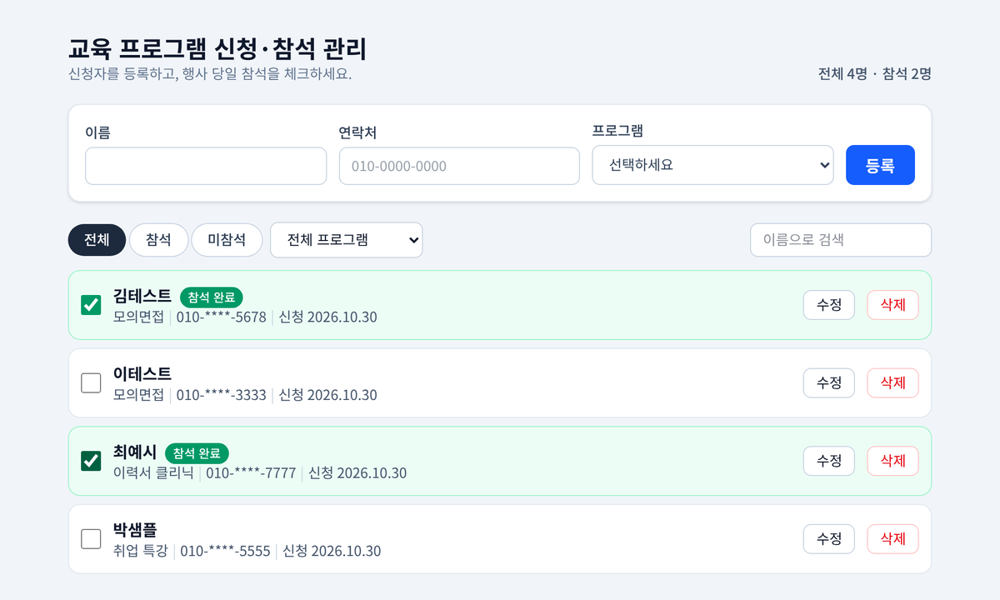

# 교육 프로그램 신청·참석 관리 앱

교육기관 운영 담당자가 프로그램 신청자를 등록하고, 행사 당일 참석을 체크하고, 프로그램별로 골라 보는 웹 앱입니다.
현재 버전: **v1.1** (CSV 내보내기·프로그램별 요약까지)



> 화면의 이름과 연락처는 모두 가짜 데이터입니다.

- 명세 문서: [docs/](docs/) 폴더 (IDEA → PRD → TRD → DATA_MODEL → API_SPEC → COMPONENT_SPEC → TEST_CASES)

## 주요 기능
- 신청자 등록 (이름·연락처·프로그램), 연락처는 숫자만 쳐도 하이픈 자동 입력
- 같은 연락처로 같은 프로그램에 중복 신청 막기
- 참석 체크와 "전체 N명 · 참석 M명" 요약, 처리 중에는 버튼을 잠가 두 번 눌림 방지
- 참석 여부·프로그램 필터, 이름 검색
- 정보 수정 (실패하면 입력값 유지), 삭제 전 한 번 더 확인
- 명단의 연락처는 가운데를 가려서 표시 (`010-****-5678`)
- 프로그램별 신청·참석 인원과 참석률 카드
- 지금 보이는(필터된) 명단을 엑셀용 CSV로 내려받기 (`신청자명단_YYYYMMDD.csv`, 연락처 전체 포함이라 파일 관리 주의)

## 기술 스택
- 화면: Next.js 15, React 19, TypeScript, Tailwind CSS, Jest + React Testing Library
- 서버: Python 3.12+, FastAPI, Pydantic v2, uv
- DB: SQLAlchemy 2.0 + Alembic (개발: SQLite 파일 / 배포: Neon Postgres)

## 폴더 구조

수업의 Todo 앱 가이드 구조(화면은 `app/`·`src/`, 서버는 `backend/`, 명세는 `docs/`)를 따릅니다. 자세한 설명은 [docs/TRD.md](docs/TRD.md)에 있습니다.

```text
personal_project/
├─ CLAUDE.md                    # 클로드 작업 규칙 (기술 스택, 폴더 구조, 금지 사항)
├─ README.md                    # 프로젝트 소개, 실행 방법 (지금 보는 문서)
├─ package.json                 # 화면 쪽 패키지와 명령 (npm run dev:all 등)
├─ dev-all.ps1                  # 서버와 화면을 터미널 하나로 켜는 스크립트
├─ .env.example                 # 화면용 환경 변수 예시 (NEXT_PUBLIC_API_URL)
│
├─ docs/                        # 명세 문서 (코드보다 먼저 씀)
│  ├─ IDEA.md                   # 아이디어, MVP, 빼는 것, 버전 로드맵
│  ├─ PRD.md                    # 기능 목록(F-01~), 사용자 스토리, 화면 문구
│  ├─ TRD.md                    # 기술 선택 이유, 폴더 구조, 데이터 흐름
│  ├─ DATA_MODEL.md             # 테이블과 필드, 검사 규칙
│  ├─ API_SPEC.md               # API 주소, 요청·응답, 에러 형식
│  ├─ COMPONENT_SPEC.md         # 화면 부품, Props, 동작과 문구
│  ├─ TEST_CASES.md             # 테스트 ID와 기대 결과 ("완성"의 기준)
│  └─ images/screenshot.png     # README용 실행 화면
│
├─ app/                         # Next.js 페이지
│  ├─ layout.tsx                # 모든 페이지를 감싸는 틀
│  ├─ page.tsx                  # 메인 화면 (데이터와 서버 호출을 맡는 "지휘자")
│  └─ globals.css               # Tailwind 불러오기
│
├─ src/
│  ├─ components/               # 화면 부품 (+ 같은 이름의 .test.tsx)
│  │  ├─ ApplicantForm.tsx      # 신청자 등록 폼
│  │  ├─ ApplicantList.tsx      # 명단 목록
│  │  ├─ ApplicantItem.tsx      # 신청자 한 줄 (참석 체크, 수정, 삭제 확인)
│  │  ├─ ApplicantFilter.tsx    # 참석 여부·프로그램 필터, 이름 검색
│  │  ├─ ApplicantSummary.tsx   # 전체 N명 · 참석 M명
│  │  ├─ ProgramSummary.tsx     # 프로그램별 신청·참석 인원과 참석률
│  │  └─ ExportButton.tsx       # 명단 CSV 내보내기
│  ├─ lib/                      # 화면과 분리된 함수 (+ .test.ts)
│  │  ├─ applicantApi.ts        # FastAPI를 부르는 함수 모음
│  │  ├─ validation.ts          # 입력값 검사 (서버와 같은 규칙·문구)
│  │  ├─ filterApplicants.ts    # 필터 계산
│  │  ├─ format.ts              # 연락처 가리기, 하이픈 자동 입력, 날짜 표시
│  │  └─ report.ts              # CSV 만들기, 프로그램별 요약 계산
│  ├─ types/applicant.ts        # 공유 타입, 프로그램 목록
│  └─ test-utils/makeApplicant.ts  # 테스트용 가짜 신청자
│
└─ backend/                     # FastAPI 서버
   ├─ pyproject.toml            # 서버 쪽 패키지와 pytest 설정
   ├─ uv.lock                   # 설치된 패키지 버전 고정
   ├─ .env.example              # 서버용 환경 변수 예시 (DB 주소, CORS)
   ├─ alembic.ini               # DB 마이그레이션 설정
   ├─ alembic/versions/         # 테이블을 만들고 바꾼 기록
   ├─ app/
   │  ├─ main.py                # 서버 시작점: CORS, 에러 형식 통일, 라우터 등록
   │  ├─ routers/applicants.py  # /api/applicants 주소별 처리 (GET·POST·PATCH·DELETE)
   │  ├─ schemas.py             # 요청·응답 검사 (Pydantic)
   │  ├─ repository.py          # 저장소 약속(Protocol) + 메모리 저장소
   │  ├─ sql_repository.py      # DB 저장소
   │  ├─ deps.py                # 라우터에 저장소를 넣어 주는 곳 (get_repo)
   │  ├─ models.py              # DB 테이블 정의
   │  ├─ db.py                  # DB 연결과 세션
   │  ├─ config.py              # .env 설정 읽기
   │  └─ errors.py              # 404·409용 에러
   └─ tests/                    # pytest 테스트 (입력 검사, 저장소, API)
```

## 처음 한 번만 준비하기 (Windows PowerShell)

필요한 프로그램: Node.js LTS(`node -v`), Python 3.12 이상(`python --version`), uv(`uv --version`)
uv가 없으면: `powershell -ExecutionPolicy ByPass -c "irm https://astral.sh/uv/install.ps1 | iex"`

```powershell
# 0) uv 위치와 SQLAlchemy 설정을 계속 유지 (한 번만 실행 후 VS Code 재시작)
[Environment]::SetEnvironmentVariable("Path", "$env:USERPROFILE\.local\bin;" + [Environment]::GetEnvironmentVariable("Path", "User"), "User")
[Environment]::SetEnvironmentVariable("DISABLE_SQLALCHEMY_CEXT_RUNTIME", "1", "User")

# 1) 화면 쪽 패키지 설치 (프로젝트 최상위 폴더에서)
npm install

# 2) 화면용 서버 주소 파일 만들기
copy .env.example .env.local

# 3) 서버 쪽 패키지 설치 + DB 테이블 만들기
cd backend
uv sync
uv run python -m alembic upgrade head
cd ..
```

`.env.local`이 없어도 기본 주소(`http://localhost:8000`)로 동작합니다. 서버 설정을 바꾸려면 `backend/.env.example`을 복사해 `backend/.env`를 만드세요.

## 실행하기 (터미널 하나)

```powershell
npm run dev:all
```

- 서버(`http://localhost:8000/docs`, API 시험 화면)와 화면(`http://localhost:3000`)이 함께 켜집니다.
- `Ctrl + C` 한 번으로 둘 다 꺼집니다.
- 3000번을 다른 프로그램이 쓰고 있으면 먼저 정리하고 켭니다.

따로 켜고 싶을 때는 터미널 2개를 씁니다.

```powershell
# 터미널 1: 서버
cd backend
uv run python -m fastapi dev app/main.py

# 터미널 2: 화면
npm run dev
```

## 테스트

```powershell
npm test                                  # 화면 테스트 (Jest)
cd backend
uv run python -m pytest                    # 서버 테스트 (메모리 저장소)
uv run python -m pytest -m db              # DB 저장소 테스트 (backend/test.db)
```

## Windows에서 막힐 때

| 증상 | 해결 |
| --- | --- |
| `uv` 용어를 인식할 수 없음 | 위 0) 설정 후 VS Code 재시작. 급하면 `$env:Path = "$env:USERPROFILE\.local\bin;$env:Path"` |
| `애플리케이션 제어 정책에서 이 파일을 차단했습니다` (`alembic.exe` 등) | `uv run 명령` 대신 `uv run python -m 명령`으로 실행 |
| `DLL load failed ... _cache_key_cy` | `$env:DISABLE_SQLALCHEMY_CEXT_RUNTIME = "1"` 후 다시 실행 (0) 설정 시 자동) |
| 화면에 "서버에 연결할 수 없습니다" | 서버가 꺼져 있음. `npm run dev:all`로 다시 켜고 `http://localhost:8000/health` 확인 |

## 배포 환경 변수 (v1.0에서 사용, 실제 값은 쓰지 않음)

| 서비스 | 변수 이름 | 예시 값 | 설명 |
| --- | --- | --- | --- |
| Render | `DATABASE_URL` | `postgresql+psycopg://...` | Neon main 브랜치 주소 |
| Render | `CORS_ORIGINS` | `https://○○.vercel.app` | 허용할 화면 주소, 쉼표로 여러 개, 끝에 `/` 없이 |
| Vercel | `NEXT_PUBLIC_API_URL` | `https://○○.onrender.com` | 서버 주소, 끝에 `/` 없이 |

Render 설정: Root Directory `backend`, Build `pip install uv && uv sync --frozen`,
Start `uv run uvicorn app.main:app --host 0.0.0.0 --port $PORT`, Health Check `/health`
(`backend/uv.lock`을 꼭 커밋하세요. `--frozen`이 이 파일을 씁니다.)

## 개인정보
- 시연용 프로젝트입니다. **실제 이름과 전화번호를 입력하지 마세요.** 테스트와 시연에는 가짜 데이터만 씁니다.
- 화면의 연락처는 가려서 보여주지만, 로그인 기능이 아직 없어서 서버 주소를 알면 전체 번호를 볼 수 있습니다. 실제 운영 전에는 로그인(로드맵 v2.0)이 필요합니다.
